# PrismServe

**Vision inference with bounded dynamic batches, real transfer learning, and a custom Triton preprocessing kernel whose GPU evidence is still pending.**

PrismServe owns the path from pinned image bytes and pretrained weights to an HTTP prediction: image validation, authentic pretrained geometry, admission control, deadlines, batching, model execution, content-based model identity, and measured failure recovery. A fused Triton kernel replaces RGB uint8 conversion, normalization, and NHWC→NCHW layout. Its comparison includes eager PyTorch and `torch.compile`, plus the complete tensor pipeline and real HTTP workloads.

**Current status:** CPU implementation and measurements are verified. NVIDIA execution, Triton correctness/performance, CUDA profiler traces, and cloud deployment are **not yet verified**. The GPU gate exits unsuccessfully on this Apple laptop; MPS and CPU results cannot satisfy it. No cloud resources were provisioned by this project preparation.

## What is measured

The checked-in [vision report](evidence/cpu-evaluation.json) uses 1,100 deterministically selected Imagenette images: 600 for learning a frozen-backbone linear head, 200 for selecting weight decay, and 300 from the official validation directory for final assessment. The backbone is the real torchvision ResNet18 ImageNet model. Three AdamW head candidates are trained for 120 epochs; train-only feature standardization is folded into the exported affine classifier.

| Final assessment, 300 labeled images | Accuracy |
|---|---:|
| Original 1,000-class pretrained model | 64.67% |
| Pretrained logits restricted to the 10 known Imagenette classes | **97.33%** |
| Trained 10-class head | 95.33% |
| Trained head after radius-2 Gaussian blur | 76.00% |

The head loses **2.0 percentage points** against the stronger mapped baseline; the paired bootstrap 95% interval is **−4.0 to −0.33 points**. The improvement gate fails. It would be misleading to compare only against the unrestricted 1,000-class model: knowing the label space supplies a large advantage by itself. The API defaults to the original pretrained classifier. An explicit `--head` enables the research head.

Imagenette comes from ImageNet. The backbone was pretrained on source training images, and its published development also used ImageNet validation. These are held-out examples for **this head training process**, not a new independent generalization benchmark. Exact byte and decoded-pixel duplicate checks passed on the selected subset; perceptual duplicates and independent label adjudication remain unverified. See the [data/model card](docs/data-model-card.md) and [failure analysis](docs/failure-analysis.md).

## Run locally

Use Python 3.12. Initial weights and data downloads total about 145 MB; allow at least 2 GB of free disk for the environment, extracted images, and working files. Commands are relative to this directory.

```sh
python3.12 -m venv .venv
.venv/bin/python -m pip install -r requirements-macos.lock
.venv/bin/python -m pip install --no-deps .
.venv/bin/python -m pytest -q -m 'not gpu' -W error
.venv/bin/prism prepare
.venv/bin/prism extract --output runs/reproduce/features.npz
.venv/bin/prism train --features runs/reproduce/features.npz --output artifacts/reproduce
.venv/bin/prism evaluate --features runs/reproduce/features.npz \
  --artifact artifacts/reproduce --output runs/reproduce/evaluation.json
.venv/bin/prism serve --device cpu --port 8766
```

For Linux CPU environments, first install `torch==2.9.0 torchvision==0.24.0` from the [official CPU wheel index](https://download.pytorch.org/whl/cpu), then install `requirements-common.lock` and the project with `--no-deps`. Noneditable installation avoids a local macOS `.pth` visibility issue; reinstall after source changes. This standalone checkout uses ordinary ignored local environment/data directories; `--data` and `--weights` also accept external paths. No images, pretrained weights or learned head binaries are bundled.

Send any local JPEG or PNG up to the documented caps:

```sh
curl --fail http://127.0.0.1:8766/ready
curl --fail -H 'Content-Type: image/jpeg' --data-binary @your-image.jpg \
  'http://127.0.0.1:8766/v1/predict?timeout_ms=1000&embedding=true'
curl --fail http://127.0.0.1:8766/v1/model
curl --fail http://127.0.0.1:8766/v1/stats
```

`embedding=true` includes a normalized 512-dimensional backbone vector. Responses carry a model content ID and a request ID header. Raw images are not logged. `/live` reports process liveness; `/ready` becomes healthy only after weight validation, model construction, and a warmup inference. A worker exception drains queued work and disables readiness; a fresh process is required to recover.

## Serving architecture

```mermaid
flowchart LR
    I[JPEG / PNG] --> A[Bound requests and bytes]
    A --> D[Bounded decoder threads]
    D --> G[Official PIL resize 256 / center crop 224]
    G --> Q[Deadline-aware admitted queue]
    Q --> B[Dynamic batches / one model thread]
    B --> P[Native / compiled / Triton normalize + layout]
    P --> R[ResNet18 / optional trained head]
    R --> O[Top 5 / optional embedding / model ID]
```



The default limits are 64 admitted HTTP requests, 64 queued plus executing images, batches of up to 8, and a 5 ms batching window. Decoder tasks retain capacity even when the requesting client times out. Cancellation removes queued work; already launched device work is allowed to finish and its late result is discarded. No cancellation claim implies GPU kernel preemption. Errors are explicit: 413 byte cap, 415 media type, 422 image/parameter validation, 429 overload, 503 unavailable worker, and 504 deadline. See [architecture](docs/architecture.md).

The local [HTTP report](evidence/cpu-http-final.json) contains 12 real TCP workloads, with batch caps 1/8, waits 0/5 ms, and client concurrency 1/8/32. All **360 normal requests succeeded**. Single-client medians ranged from about 12–38 ms; concurrent workloads ranged from 28–97 successful images/s. These are short 30-request observations on a shared Apple M4 Pro laptop, not stable throughput claims. Four 256-request overload/deadline drills returned bounded 429/504 responses; malformed-image requests returned 422 followed by successful requests. CPU batching did not show a consistent advantage. Reproduce using `scripts/http_experiment.py`; the GPU run uses 100 requests per workload and batch caps 1/8/32.

## GPU evidence gate

The custom kernel takes an already resized/cropped RGB uint8 NHWC tensor. It supports non-contiguous strides, masks tail elements, and writes contiguous FP32 NCHW output. Geometry is identical across paths; no faster but different resize is substituted. The native transform is checked exactly against torchvision's official weights transform and independently against NumPy. The kernel itself requires real CUDA parity tests.

On an approved NVIDIA Linux host, follow [the bounded GPU run plan](docs/gpu-run-plan.md). The exact commands are in `scripts/run_gpu.sh`. They fail if CUDA is absent and retain:

- Tail/stride/batch parity against native PyTorch, plus classifier logit and top-1 parity.
- Eager PyTorch, `torch.compile`, and custom Triton comparisons at batches 1/8/32.
- CUDA-event p50/p95, first-call compilation cost, incremental device memory, and profiler trace.
- Separate tensor-pipeline and complete HTTP measurements, including queueing and decoding.
- Labeled evaluation and actual GPU/device/software metadata.

A fast normalization microbenchmark alone does not establish faster inference. Compilation and warmups are separated from steady-state timings. The recorded report must compare Triton against the **fastest library baseline**, retain slowdowns, and measure how much preprocessing contributes to total latency before asserting value.

## Evidence boundaries

The historical CPU suite passed **40 tests**, including two private provisioning-helper tests. Those two account-specific tests and their helper are excluded from this public export; the product CPU suite contains **38 tests** with warnings treated as errors. The GPU suite is deliberately separate and currently has 11 tests requiring real NVIDIA hardware. [Verification notes](docs/verification.md) record what has actually run. Hosted CI remains unrun. The [independent employer review](docs/independent-employer-review.md) accepted the bounded CPU artifact after adversarial probes and exact training/evaluation replay; GPU acceptance remains pending.

This project demonstrates bounded CPU vision training/evaluation and serving behavior. GPU programming, CUDA profiler evidence, physical-camera experience, production operations and an owned compiler runtime remain unverified. Invoking `torch.compile` is a library baseline, not ownership of a compiler. The source and review are AI-assisted; artifact verification does not establish personal mastery. See [public export provenance](PUBLICATION.md).
